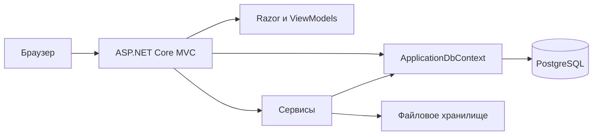

<div align="center">

# HealthCard.Web

### Карточка здоровья

Личный архив медицинских записей, результатов анализов и документов.


**Дипломный проект на C# и ASP.NET Core**

</div>

## О проекте

**Карточка здоровья** — веб-приложение для организации личного медицинского архива. Пользователь может сохранять исследования по категориям, вводить показатели лабораторных анализов, прикреплять бланки и просматривать историю результатов.

Приложение объединяет два вида записей: лабораторные анализы с числовыми показателями и исследования с документами — УЗИ, МРТ/КТ, ЭКГ и заключения специалистов.

Сравнение показателей с заданными интервалами помогает наглядно представить результаты. Цветовая индикация служит для отображения данных и не является медицинским диагнозом.

## Основные возможности

- **Учетная запись:** регистрация, вход и выход через ASP.NET Core Identity.
- **Главная панель:** количество записей, группы категорий и пять последних исследований по дате.
- **Медицинские записи:** добавление, просмотр и удаление с подтверждением.
- **Лабораторные результаты:** ввод числовых значений с отображением единиц измерения и просмотр динамики в таблице по датам.
- **Вложения:** загрузка PDF, JPG, JPEG и PNG размером до 10 МБ.
- **Поиск в архиве:** фильтрация записей по категории и диапазону дат.

### Справочник исследований

При начальном заполнении создаются **11 категорий** и **55 лабораторных показателей**.

| Лабораторные анализы | Количество показателей |
| --- | ---: |
| Общий анализ крови | 22 |
| Биохимический анализ крови | 15 |
| Липидный профиль | 5 |
| Гормоны щитовидной железы | 5 |
| Общий анализ мочи | 8 |

Для документов предусмотрены категории **УЗИ**, **МРТ/КТ**, **ЭКГ**, **заключение врача**, **рентген** и **флюорография**.

## Технологии

| Технология | Назначение |
| --- | --- |
| C# и .NET 10 | Язык и платформа серверной части |
| ASP.NET Core MVC и Razor | Обработка запросов и формирование HTML-страниц |
| Entity Framework Core | Работа с сущностями, LINQ-запросы и миграции |
| PostgreSQL и Npgsql | Реляционная база данных и провайдер доступа |
| ASP.NET Core Identity | Пользователи, проверка паролей и аутентификация через cookie |
| Bootstrap 5 и Bootstrap Icons | Адаптивная сетка, компоненты интерфейса и пиктограммы |

## Архитектура

Приложение построено по MVC и разделено на проекты по ответственности. Часть операций вынесена в сервисы; контроллеры также напрямую используют контекст Entity Framework Core.

```text
HealthCard.Web/
├── HealthCard.Web/      # Program, контроллеры, Razor-представления и веб-ресурсы
├── Models/              # Сущности предметной области и методы их изменения
├── Data/                # Контекст базы, миграции и начальный справочник
├── Services/            # Сервисы категорий и файлового хранилища
├── ViewModels/          # Модели форм и экранов
└── HealthCard.Web.slnx  # Файл решения
```



### Основные сущности

| Класс | Что описывает |
| --- | --- |
| `ApplicationUser` | Пользователь и сведения профиля |
| `Category` | Категория анализа или исследования |
| `MedicalRecord` | Конкретная медицинская запись с датой, описанием и вложением |
| `TestParameter` | Название показателя, единицу измерения и общий интервал нормы |
| `TestResult` | Числовое значение показателя в конкретной записи |
| `UserParameterNorm` | Персональный интервал показателя для пользователя |

Например, **«Липидный профиль»** — категория, **«Общий холестерин»** — показатель, а его значение в исследовании за определенную дату — результат.

### Принципы организации кода

- Внедрение зависимостей через конструкторы и встроенный DI-контейнер.
- Небольшие интерфейсы `ICategoryService` и `IFileStorageService`.
- Именованные фабричные методы `Create`, `CreateSystem` и `CreateUser` для создания сущностей с проверками.
- Закрытые сеттеры и методы изменения состояния для инкапсуляции правил.
- Перенаправление после успешной отправки формы — Post Redirect Get.
- Связи, внешние ключи, каскадное удаление результатов и уникальный индекс персональных норм на уровне базы.

## Локальный запуск

### Требования

- .NET SDK 10.
- Запущенный PostgreSQL и учетная запись с правами на выбранную базу.
- Git и доступ к NuGet для восстановления зависимостей.

### 1. Получить исходники

```bash
git clone https://github.com/GKSalamanca/HealthCard.Web.git
cd HealthCard.Web
dotnet restore HealthCard.Web.slnx
```

### 2. Подготовить базу

Создайте пустую базу в PostgreSQL, например через SQL-редактор:

```sql
CREATE DATABASE "HealthCardDb";
```

### 3. Настроить подключение

В веб-проекте уже задан `UserSecretsId`. Сохраните строку подключения в User Secrets, заменив пользователя и пароль своими значениями:

```bash
dotnet user-secrets set "ConnectionStrings:DefaultConnection" "Host=localhost;Port=5432;Database=HealthCardDb;Username=postgres;Password=YOUR_PASSWORD" --project HealthCard.Web/HealthCard.Web.csproj
```

Реальные учетные данные следует хранить вне файлов репозитория. User Secrets используется для локальной разработки.

### 4. Запустить приложение

```bash
dotnet build HealthCard.Web.slnx
dotnet dev-certs https --trust
dotnet run --project HealthCard.Web/HealthCard.Web.csproj --launch-profile https
```

Откройте **https://localhost:7274**, зарегистрируйтесь и войдите в приложение. Порт указан в `launchSettings.json` для локального HTTPS-профиля.

При запуске приложение пытается применить миграции и заполнить справочник. Начальное заполнение выполняется, если таблица категорий пуста. Bootstrap и пиктограммы подключаются через CDN, поэтому для их загрузки требуется доступ к сети.

## Статус и дальнейшее развитие

Проект развивается как дипломное приложение. Модель персональных норм и ее чтение в карточке записи уже предусмотрены; интерфейсы настройки профиля, персональных норм и пользовательских категорий требуют завершения. Отдельный экран аналитики и экспорт PDF пока не реализованы.

Следующие направления работы:

- Защищенная выдача вложений с проверкой владельца.
- Единый сервис медицинских записей и расчета статусов показателей.
- Общая транзакция сохранения записи и результатов с обработкой файловых сбоев.
- Улучшение валидации форм и типизированных моделей представления.
- Автоматизированные тесты основных пользовательских сценариев.

## Автор

[GKSalamanca](https://github.com/GKSalamanca)
