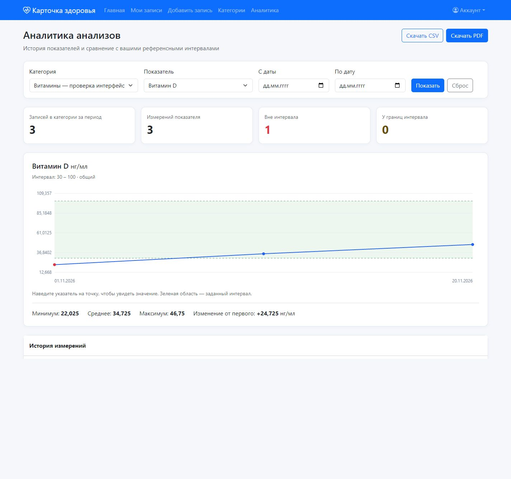
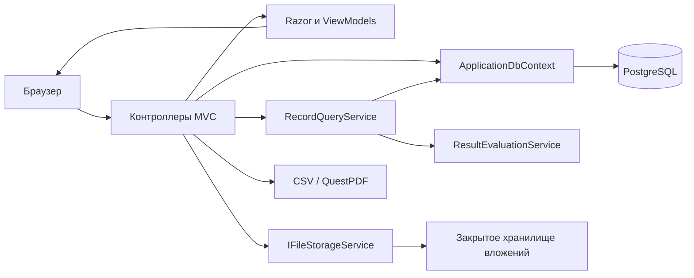

<div align="center">

# HealthCard.Web

### Карточка здоровья

Личный медицинский архив с аналитикой результатов, своими категориями анализов и персональными интервалами.


**Дипломный проект на C# и ASP.NET Core**

</div>

## О проекте

**Карточка здоровья** — веб-приложение для хранения медицинских записей, лабораторных результатов и документов. Оно помогает собрать историю исследований в одном месте, сравнивать показатели за разные даты и просматривать их динамику.

Приложение поддерживает лабораторные анализы с числовыми результатами и исследования с вложениями: УЗИ, МРТ/КТ, ЭКГ, рентген и заключения специалистов. Кроме базового справочника пользователь может создавать свои категории, добавлять показатели и задавать персональные интервалы.

## Возможности

- **Личный кабинет:** регистрация, вход, выход, изменение профиля и пароля.
- **Медицинские записи:** создание, просмотр, редактирование, удаление, фильтрация по категории и датам, страницы списка по 12 записей.
- **Базовые категории:** ОАК, биохимия, липидный профиль, гормоны щитовидной железы, ОАМ, УЗИ, МРТ/КТ, ЭКГ и другие исследования.
- **Свои категории:** лабораторный анализ с собственными показателями, единицами и интервалами либо категория для документов. Можно добавлять и редактировать показатели; использованные показатели защищены от удаления.
- **Аналитика:** график выбранного показателя, фильтры по категории и датам, минимум, максимум, среднее, изменение между первым и последним результатами, число измерений вне интервала и у его границ.
- **История категории:** сравнительная таблица. Несколько исследований за один день отображаются отдельными записями.
- **Персональные интервалы:** свои границы для каждого показателя и возврат к общим значениям. Они применяются одинаково в карточке записи, истории, аналитике и экспорте.
- **Экспорт:** CSV и PDF по выбранному показателю и периоду. На странице показываются последние 200 строк истории, экспорт содержит все результаты фильтра.
- **Вложения:** PDF, JPG и PNG размером до 10 МБ; загрузка, замена, удаление и скачивание владельцем записи.
- **Главная страница:** реальные количества записей, категорий, измерений вне интервала и последние исследования.

Статусы сравнивают введенные значения с заданными интервалами. Приложение не ставит диагнозы. Справочные интервалы можно уточнить через раздел «Персональные нормы».

## Пример аналитики



На графике отображаются измерения выбранного показателя и область заданного интервала. Под графиком доступны сводные значения и таблица истории.

## Базовый справочник

При заполнении новой базы создаются **11 категорий**, включая пять лабораторных категорий с **55 показателями**.

| Лабораторные анализы | Показателей |
| --- | ---: |
| Общий анализ крови (ОАК) | 22 |
| Биохимический анализ крови | 15 |
| Липидный профиль | 5 |
| Гормоны щитовидной железы | 5 |
| Общий анализ мочи (ОАМ) | 8 |

Для исследований и документов предусмотрены **УЗИ**, **МРТ/КТ**, **ЭКГ**, **заключение врача**, **рентген** и **флюорография**. Базовый справочник дополняется собственными категориями пользователя.

## Технологии

| Технология | Назначение |
| --- | --- |
| **C# / .NET 10** | Язык и платформа серверной части |
| **ASP.NET Core MVC / Razor** | Контроллеры, маршрутизация, обработка форм и HTML-представления |
| **Entity Framework Core 10.0.12** | Сущности, LINQ-запросы, связи, транзакции и миграции |
| **PostgreSQL / Npgsql EF Core 10.0.3** | Реляционная база данных и провайдер доступа |
| **ASP.NET Core Identity** | Пользователи, хеширование паролей и cookie-аутентификация |
| **QuestPDF** | Формирование PDF-отчетов с кириллицей |
| **Bootstrap 5.3.3 / Bootstrap Icons 1.11.0** | Адаптивная сетка, компоненты интерфейса и пиктограммы |
| **jQuery 3.7.1 / jQuery Validation / Unobtrusive Validation** | Клиентская проверка форм |
| **JavaScript / Fetch API / Canvas API** | Подгрузка показателей, редактирование списка полей и графики |

Стили, скрипты и шрифты интерфейса подключаются из локальных файлов проекта. Для их загрузки приложению не требуется CDN.

## Локальный запуск

Нужны .NET SDK 10, доступный сервер PostgreSQL и доступ к NuGet для первоначального восстановления зависимостей. Откройте `HealthCard.Web.slnx` в Visual Studio и выберите `HealthCard.Web` запускаемым проектом. Существующая строка подключения в User Secrets продолжает использоваться.

Для получения исходников:

```bash
git clone https://github.com/GKSalamanca/HealthCard.Web.git
cd HealthCard.Web
```

Для нового окружения задайте подключение, подставив свои значения:

```powershell
dotnet user-secrets set "ConnectionStrings:DefaultConnection" "Host=localhost;Port=5432;Database=HealthCard;Username=postgres;Password=YOUR_PASSWORD" --project HealthCard.Web
```

Запуск из корня репозитория:

```powershell
dotnet restore HealthCard.Web.slnx
dotnet run --project HealthCard.Web --launch-profile https
```

Страница приложения: [https://localhost:7274](https://localhost:7274). Профиль `http` использует [http://localhost:5118](http://localhost:5118). Строка подключения также может поступать через переменную окружения `ConnectionStrings__DefaultConnection`.

При старте применяются миграции EF Core и добавляются отсутствующие базовые категории/показатели. Повторный запуск не создает дубликаты справочников. Ошибка подключения к PostgreSQL выводится в журнал запуска.

Новая миграция `PreserveMeasurementPrecision` расширяет пять числовых полей с `numeric(10,2)` до `numeric(12,4)`: результаты и общие/персональные границы. Существующие значения сохраняются; ранее утраченные знаки после запятой автоматически не восстанавливаются. Откат этой миграции снова уменьшает точность.

Новые вложения хранятся в `HealthCard.Web/App_Data/uploads/<UserId>`. При необходимости корень задается настройкой `Storage:Root`. Старые вложения из `wwwroot/uploads` поддерживаются через защищенный маршрут скачивания; прямые HTTP-запросы к `/uploads` блокируются. Папки с медицинскими файлами исключены из Git.

## Как пользоваться своими категориями

1. Откройте **Категории → Создать свою категорию** или соответствующую кнопку на главной.
2. Введите название и выберите тип. Для лабораторного анализа добавьте показатели с единицами и нижней/верхней границами.
3. Сохраните категорию и нажмите **Добавить запись**. Своя категория также появится в общем выборе категорий.
4. Введите дату, название, измеренные значения и при необходимости прикрепите файл. Неизмеренные показатели можно оставить пустыми.
5. Откройте **Аналитика и графики**, выберите показатель и период. Кнопки **Скачать CSV/PDF** выгружают результаты текущего фильтра.

Свои категории видны только владельцу. Системные категории доступны всем пользователям и защищены от редактирования/удаления. Категорию с записями удалить нельзя: сначала необходимо удалить ее записи. Тип сохраненной категории и категория сохраненной записи не меняются, чтобы не нарушать связь истории с показателями.

## Архитектура

Проект использует **MVC** и разделение ответственности между сущностями, доступом к данным, сервисами и моделями представления. Контроллеры работают с контекстом EF Core; общие запросы и оценка результатов вынесены в отдельные сервисы.

| Проект / папка | Назначение |
| --- | --- |
| `HealthCard.Web` | Контроллеры MVC, Razor-страницы, авторизация, JavaScript и CSS |
| `Models` | Сущности: Category, TestParameter, MedicalRecord, TestResult, ApplicationUser, UserParameterNorm |
| `Data` | ApplicationDbContext, связи, миграции и заполнение базовых справочников |
| `Services` | Хранение вложений и единая оценка результатов через интерфейсы |
| `ViewModels` | Модели ввода, проверки данных и модели отображения |
| `HealthCard.Web/Services/RecordQueryService.cs` | Запросы данных текущего пользователя и применение персональных интервалов |
| `HealthCard.Checks` | Проверки доменных правил, хранилища файлов и HTTP-сценариев на отдельной базе |



### Основные сущности

| Класс | Назначение |
| --- | --- |
| `ApplicationUser` | Учетная запись и сведения профиля |
| `Category` | Системная или пользовательская категория анализа/исследования |
| `MedicalRecord` | Запись с датой, названием, комментарием и вложением |
| `TestParameter` | Показатель, единица измерения и общий интервал |
| `TestResult` | Значение показателя в конкретной медицинской записи |
| `UserParameterNorm` | Персональный интервал показателя для пользователя |

Например, **«Липидный профиль»** — категория, **«Общий холестерин»** — показатель, а его числовое значение в исследовании за определенную дату — результат.

### Сервисы и принципы организации кода

- **`RecordQueryService`** получает результаты текущего пользователя и применяет его персональные интервалы.
- **`IResultEvaluationService` / `ResultEvaluationService`** рассчитывают общий для всех разделов статус результата.
- **`IFileStorageService` / `FileStorageService`** сохраняют, читают и удаляют вложения; поддерживают файлы из прежнего расположения.
- **Dependency Injection** передает контекст и сервисы через конструкторы.
- **Фабричные методы** `Create`, `CreateSystem` и `CreateUser` создают сущности с проверкой правил.
- **Инкапсуляция** реализована закрытыми сеттерами и методами изменения состояния.
- **Post/Redirect/Get** перенаправляет пользователя после успешного сохранения формы.
- **Транзакционное сохранение** записывает медицинскую запись и результаты одним `SaveChangesAsync`; при сбое сохранения новое вложение удаляется.

### Данные и доступ

- Проверка владельца выполняется на сервере для записей, своих категорий, норм и скачивания вложений.
- Изменяющие POST-запросы требуют antiforgery-токен.
- Состав показателей, значения и интервалы повторно проверяются на сервере; клиент не задает доверенные границы нормы.
- Файлы проверяются по расширению, начальной сигнатуре и размеру.
- Пользовательские строки в CSV экранируются, в том числе при начале строки с символа формулы.
- Реальные учетные данные подключения хранятся в конфигурации окружения или User Secrets.

Правило статусов находится в `ResultEvaluationService`: за пределами `[min; max]` — «Вне интервала»; внутри него при `value <= min × 1.1` либо `value >= max × 0.9` — «У границы»; остальные значения — «В интервале». Это сохраненное правило исходного проекта, общее для всех страниц.

## Проверки

По протоколу от **25.11.2026**:

| Проверка | Результат |
| --- | --- |
| Сборка решения | 0 ошибок, 0 предупреждений |
| Правила моделей и файловое хранилище | 27 проверок пройдено |
| HTTP-сценарии на отдельной PostgreSQL-базе | 120 проверок пройдено |
| Модель EF Core | Соответствует последней миграции |
| Интерфейс | Проверены формы, меню и графики на узком и настольном экранах |

Проверки охватывают работу записей, категорий, норм, профиля, вложений, экспорта, разбиения на страницы, валидации и разделения данных двух пользователей.

[Подробный протокол и сценарий демонстрации](docs/VERIFICATION.md) · [Результаты HTTP-проверок](docs/qa/http-results.json)

<details>
<summary>Как запустить проверки</summary>

```powershell
dotnet build HealthCard.Web.slnx
dotnet run --project HealthCard.Checks --no-build
```

Интеграционные проверки используют отдельную PostgreSQL-базу с обязательным префиксом `HealthCardCodexQA_`. Тестовый запуск не подключается к базе приложения для изменения ее таблиц.

В первом терминале:

```powershell
$env:HEALTHCARD_QA_STORAGE = Join-Path $env:TEMP 'HealthCardCodexQA_files'
$env:HEALTHCARD_QA_STOP = Join-Path $env:TEMP 'HealthCardCodexQA_stop.txt'
# Выберите новый путь STOP, если файл с этим именем уже существует.
dotnet run --project HealthCard.Checks --no-build -- --serve HealthCardCodexQA_Manual
```

Во втором терминале из корня репозитория:

```powershell
python HealthCard.Checks/http_smoke.py "$env:TEMP/HealthCardCodexQA_artifacts"
```

Сценарий сначала проверяет специальный заголовок среды `Testing` на `127.0.0.1:5168`, затем создает фиктивные аккаунты и данные. Для проверки запрета прямой раздачи вложений временно создается собственный файл в отдельной папке `wwwroot/uploads/qa-disposable-*`; он удаляется в `finally`. Запускайте сценарий локально с правом записи в репозиторий. Python 3 использует только стандартную библиотеку.

Остановка и удаление **только созданной тестовой базы**:

```powershell
Set-Content -LiteralPath $env:HEALTHCARD_QA_STOP -Value 'stop'
# Дождитесь завершения --serve в первом терминале.
dotnet run --project HealthCard.Checks --no-build -- --drop HealthCardCodexQA_Manual
```

Фиктивные аккаунты после прогона остаются исключительно в тестовой базе до ее удаления. Проверочный хост использует отдельное хранилище и временные ключи; для обычной работы запускайте `HealthCard.Web`.

</details>

## Автор

[GKSalamanca](https://github.com/GKSalamanca)

Дипломный проект **«Карточка здоровья»**.
